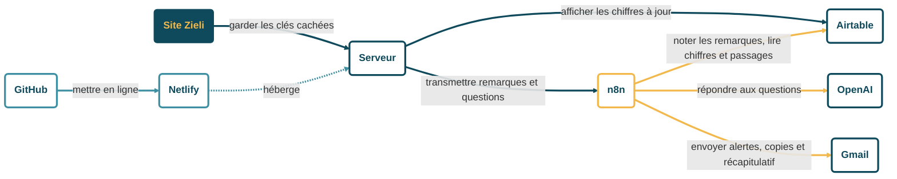
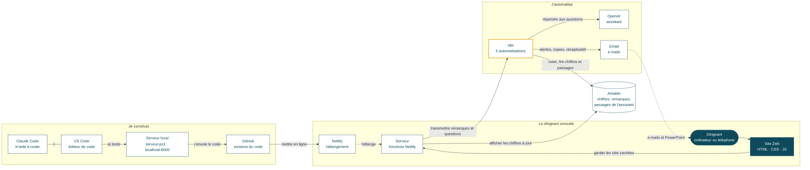

# Zieli – schéma d'architecture

*13/11/2026. Aperçu dans VS Code : Ctrl + Maj + V (extension « Markdown Preview Mermaid Support »). Pour zoomer et exporter en image : coller le bloc sur https://mermaid.live.*

## Qui parle à qui, et pourquoi

*Même contenu et mêmes couleurs que la diapositive 11 : bleu pétrole = ce qui part du site ; doré = ce que fait n8n ; bleu clair = la mise en ligne.*

**Lecture :** une case = un outil · flèche pleine = un échange, avec son « pourquoi » · flèche en pointillés = Netlify héberge le serveur.

## Vue d'ensemble en 3 rôles

*Même contenu que la diapositive « Le projet en un schéma ».*

**Lecture :** rectangle = un outil · cylindre = la base de données (Airtable) · forme arrondie = le dirigeant · flèche pleine = un échange, avec son « pourquoi » · flèche en pointillés = un lien indirect.
